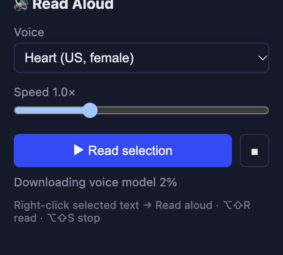
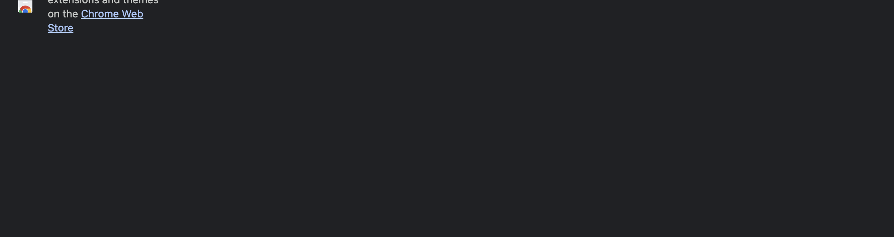
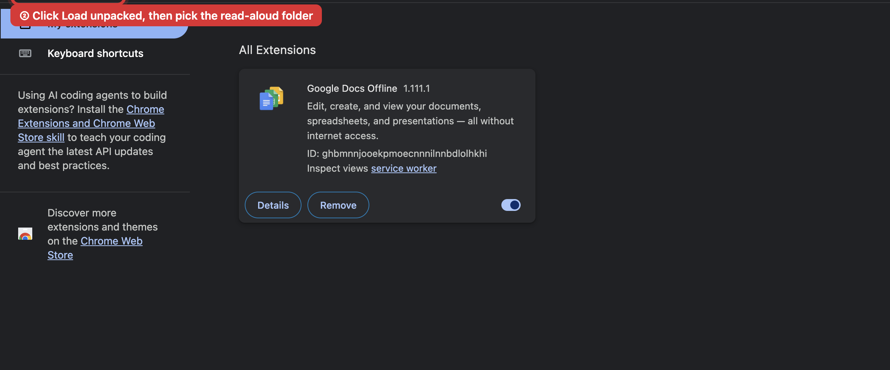
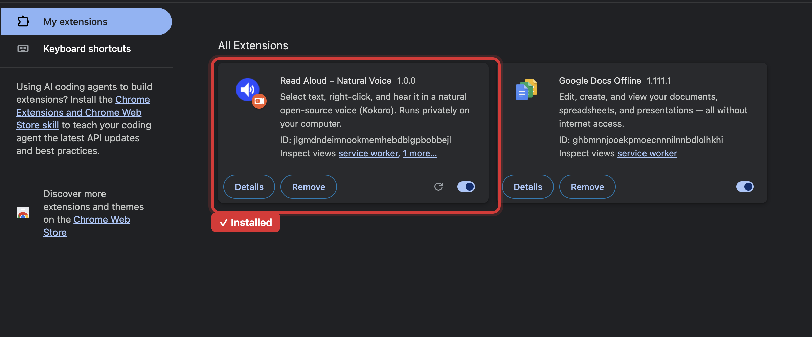

# Read Aloud – Natural Voice

A free browser extension: **select text, right-click, and hear it read aloud** in a natural-sounding voice instead of the usual robotic one. Think Speechify, but free, open source, and private.

- 🗣️ **Natural voice.** Powered by [Kokoro-82M](https://huggingface.co/hexgrad/Kokoro-82M), one of the best open-source voices available
- 🔒 **Private.** The voice runs on your own computer, so your text never leaves it
- ✈️ **Works offline** after the first use
- 🎚️ 7 voices (US and UK, male and female), speed control, pause and stop
- 🌐 Works in **Google Chrome** and **Brave** on Mac and Windows (and other Chromium browsers such as Edge)

<p align="center"></p>

## ⬇️ Install (about 5 minutes, no technical skills needed)

### 1. Download
**[Download read-aloud.zip](https://github.com/shimshihub/read-aloud/releases/latest/download/read-aloud.zip)** (about 9 MB)

### 2. Unzip it and put the folder somewhere permanent
- **Mac:** double-click the zip. A `read-aloud` folder appears.
- **Windows:** right-click the zip → **Extract All…** → **Extract**.

Move the `read-aloud` folder to your **Documents** folder (or anywhere you won't delete it). The browser loads the extension from this folder, so **don't delete it** after installing.

### 3. Open the extensions page
In the address bar, type the line for your browser and press Enter:

| Browser | Type this |
|---|---|
| Chrome | `chrome://extensions` |
| Brave | `brave://extensions` |
| Edge | `edge://extensions` |

### 4. Turn on "Developer mode"
It's a switch in the **top-right corner** of that page (in Edge it's on the left). This just allows extensions that aren't from the store. Nothing else changes.



### 5. Click "Load unpacked" and pick the folder
A **Load unpacked** button appears at the top left. Click it, select the `read-aloud` folder from step 2 (the folder itself, not a file inside it), and click **Select** / **Open**.



✅ Done! Read Aloud appears in your list, and a welcome page opens with a quick how-to.



### 6. (Recommended) Pin it
Click the puzzle-piece icon 🧩 at the top right of the browser, then the pin 📌 next to **Read Aloud – Natural Voice**.

## How to use
1. Highlight text on any web page
2. Right-click → **Read aloud**
3. The **first time**, it downloads the voice (about 330 MB, usually under a minute). After that it starts almost instantly.

Click the blue speaker icon in the toolbar to change the voice or speed, or to pause and stop.
Shortcuts: **Alt+Shift+R** reads the selection and **Alt+Shift+S** stops (on Mac: **Option+Shift+R / S**).

## Troubleshooting
- **"Manifest file is missing or unreadable"**: you picked the wrong folder. Pick the folder that directly contains `manifest.json` (open it and check).
- **No "Read aloud" in the right-click menu**: make sure you selected text first. Reload the page if you installed the extension while it was open.
- **Nothing happens the first time**: it's downloading the voice. Click the speaker icon to see the progress.
- **It doesn't read on some pages**: browsers block extensions on their own pages (like `chrome://` pages and the Web Store).
- **Updating to a new version**: download the new zip, replace the folder's contents, then click ↻ on the extension's card in the extensions page.

## Privacy
The extension has no servers, no accounts and no tracking. The text you select is processed on your computer. The only network request is the one-time download of the open-source voice model from Hugging Face.

Limitations: English only for now, and there's no word-by-word highlighting yet.

---

## For developers
```bash
npm install
npm run build        # outputs dist/ (load unpacked) and release/read-aloud.zip
```
- `src/background.js`: context menu, shortcuts, and messaging
- `src/offscreen.js`: Kokoro inference ([kokoro-js](https://www.npmjs.com/package/kokoro-js), WebGPU with a WASM fallback) and audio playback, streamed sentence by sentence
- `src/popup.*`: voice, speed and controls
- The onnxruntime wasm is bundled locally (Manifest V3 forbids remote code), and the model weights are fetched once and cached

Note: Chromium closes an offscreen document after about 30 seconds with no audible audio, whatever reason it was created with (observed in Chrome and Brave 155). The offscreen page plays an inaudible 20 Hz tone at -60 dBFS while it is busy so the first model download isn't killed.

## Credits & license
- Code: MIT, see [LICENSE](LICENSE)
- Voice model: [Kokoro-82M](https://huggingface.co/hexgrad/Kokoro-82M) by hexgrad, Apache 2.0
- Runtime: [kokoro-js](https://github.com/hexgrad/kokoro/tree/main/kokoro.js) and [Transformers.js](https://github.com/huggingface/transformers.js), Apache 2.0
